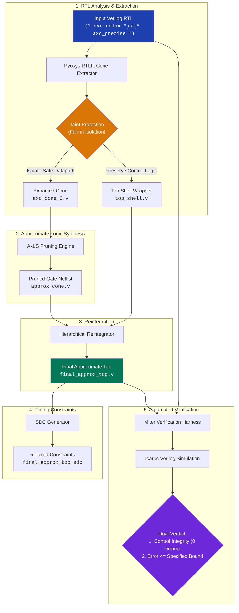

# AxSYS

> **Attribute-Driven Approximate Logic Synthesis & Verification Framework**

AxSYS is an automated, end-to-end EDA toolchain that extracts, approximates, reintegrates, and formally verifies combinational logic cones directly from standard Verilog RTL using lightweight Verilog-2001 attributes.



---

## Key Features

- **Zero RTL Rewrites**: Keep your RTL untouched. Mark relaxable arithmetic outputs with `(* axc_relax *)` and control signals with `(* axc_precise *)`.
- **Hardware Taint Protection**: Disjoint Set Union (DSU) wire aliasing and backward BFS fan-in tracing guarantee that logic feeding critical control paths is never approximated.
- **Automated Netlist Surgery**: Yosys RTLIL-level partitioning cleanly separates datapath cones into submodules and restitches synthesized gate netlists back into the top-level shell.
- **Timing Constraint Relaxation**: Automatically generates Synopsys Design Constraints (`.sdc`) with relaxed max-delay or multi-cycle paths on approximate outputs for downstream physical design.
- **Self-Verifying**: Generates side-by-side miter testbenches to verify zero control corruption and validate Mean Error Distance (MED) or Worst-Case Error (WCE) bounds under cycle-accurate simulation.

---

## RTL Attribute Specification

AxSYS parses standard Verilog-2001 attributes directly via Yosys frontends:

```verilog
module mac_pe (
    input  wire        clk,
    input  wire        rst_n,

    // Precise control paths — protected from pruning
    (* axc_precise = "1" *) input  wire valid_in,
    (* axc_precise = "1" *) output reg  valid_out,

    // Exact datapath inputs
    input  wire signed [7:0] a,
    input  wire signed [7:0] b,
    input  wire signed [15:0] c,

    // Relaxed datapath output with target error metric and bound
    (* axc_relax = "1", axc_metric = "MED", axc_bound = "0.05", axc_lsb_width = 8 *)
    output wire signed [16:0] y
);
    assign y = (a * b) + c;

    always @(posedge clk or negedge rst_n) begin
        if (!rst_n) valid_out <= 1'b0;
        else        valid_out <= valid_in;
    end
endmodule
```

### Attribute Reference

| Attribute | Accepted Values | Purpose |
|---|---|---|
| `(* axc_relax = "1" *)` | `"1"` | Identifies the target signal for backward cone extraction and approximate pruning. |
| `(* axc_precise = "1" *)` | `"1"` | Strict protection flag. Logic feeding these signals is excluded from the approximate cone. |
| `axc_metric` | `"MED"`, `"WCE"` | Optimization target: Mean Error Distance (`MED`) or Worst-Case Error (`WCE`). |
| `axc_bound` | Numeric string (e.g. `"0.05"`, `"4.0"`) | Maximum error threshold allowed during pruning. |
| `axc_lsb_width` | Integer string (e.g. `"8"`) | *(Optional)* Restricts heuristic node pruning to the $N$ least significant bits. |

---

## Prerequisites & Installation

### System Dependencies

- **Linux** (x86_64)
- **Python 3.10+**
- **Yosys** compiled with `pyosys` Python bindings
- **Icarus Verilog** (`iverilog` & `vvp`)

```bash
# Ubuntu / Debian
sudo apt-get update
sudo apt-get install -y iverilog yosys
```

### Environment Setup

```bash
git clone --recursive <repository-url>
cd axc_yosys_flow

python3 -m venv .venv
source .venv/bin/activate
pip install -r requirements.txt
```

---

## Usage

### Command Line Interface (CLI)

Run the end-to-end synthesis and verification flow:

```bash
python -m src.flow \
    --input rtl/design.v \
    --output-dir build/design_run \
    --tech NanGate15nm \
    --clk-period 5.0 \
    --samples 500 \
    --verify-cycles 500
```

#### CLI Options

| Flag | Type | Default | Description |
|---|---|---|---|
| `-i`, `--input` | Path | *Required* | Path to attribute-annotated input Verilog RTL |
| `-o`, `--output-dir` | Path | `build/axc_out` | Output directory for all generated netlists and reports |
| `--tech` | String | `NanGate15nm` | Target standard-cell library (`NanGate15nm`, etc.) |
| `--clk-port` | String | `clk` | Clock port name |
| `--clk-period` | Float | `10.0` | Clock period in nanoseconds (for SDC generation) |
| `-s`, `--samples` | Integer | `300` | Number of simulation vectors for AxLS pruning |
| `--verify-cycles` | Integer | `500` | Number of cycles to run in automated miter verification |
| `-v`, `--verbose` | Flag | `False` | Enable debug logging |

---

### Python API

```python
from pathlib import Path
from src.flow import AxcFlow

flow = AxcFlow(
    input_verilog=Path("rtl/design.v"),
    output_dir=Path("build/design_run"),
    tech="NanGate15nm",
    clk_port="clk",
    clk_period_ns=5.0,
    sim_samples=300,
    verify_cycles=500,
)

summary = flow.run()

if summary["flow_status"] == "SUCCESS":
    print(f"Synthesis Succeeded!")
    print(f"Area Savings: {summary['approximation']['area_savings_percent']:.2f}%")
    print(f"Nodes Pruned: {summary['approximation']['pruned_nodes']}")
    print(f"Control Integrity: {summary['verification']['control_integrity']}")
```

---

## Output Structure

Upon completion, the target output directory contains:

```
build/design_run/
├── cone_meta.json          # Machine-readable cone metadata and extraction report
├── extracted_cone.v        # Pure combinational RTL logic isolated from datapath
├── top_shell.v             # Golden top wrapper with submod instance
├── approx_cone.v           # Synthesized and pruned gate-level netlist
├── final_approx_top.v      # Fully reintegrated, simulatable top-level netlist
└── final_approx_top.sdc    # Generated timing constraints with relaxed output paths
```

---

## Testing

AxSYS includes self-contained test suites covering RTLIL extraction, taint analysis, and end-to-end integration:

```bash
pytest -v
```

---

## Repository Architecture

```
.
├── src/
│   ├── __init__.py
│   ├── flow.py           # Top-level pipeline orchestrator & CLI
│   ├── cone_extractor.py # RTLIL cone extraction, DSU aliasing & taint protection
│   ├── axls_bridge.py    # Subprocess bridge to AxLS heuristic pruning
│   ├── reintegrator.py   # Hierarchical netlist re-stitching
│   ├── sdc_generator.py  # SDC timing constraint generator
│   └── verifier.py       # Dual-miter automated testbench harness
├── tests/
│   ├── conftest.py
│   ├── test_cone_extractor.py # Unit tests for logic extraction & taint isolation
│   └── test_flow.py           # End-to-end pipeline integration tests
├── third_party/
│   └── AxLS/             # Approximate Logic Synthesis engine
├── requirements.txt
└── README.md
```

---

## License

This project is licensed under the Apache License 2.0. See `LICENSE` for details.
