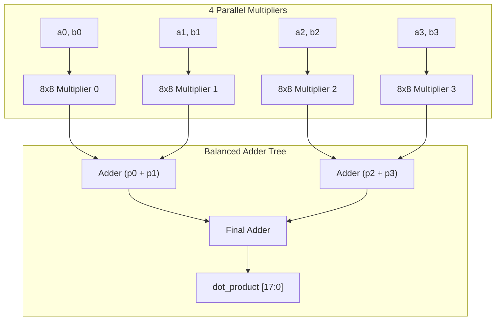

# EDA Power & Area Optimization Dashboard
## Attribute-Driven Approximate Computing (NanGate 15nm @ 100 MHz, $V_{DD} = 0.8\text{ V}$)

This dashboard presents empirical results for joint **Cell Area** and **Power Dissipation** (static leakage + dynamic switching) reduction using AxSYS attribute-driven approximate logic synthesis on open-source hardware accelerators.

---

## 1. Executive Summary

Approximate Logic Synthesis (ALS) simultaneously reduces silicon die area, static leakage power, and dynamic switching capacitance. Two representative deep-learning hardware units from third-party open-source repositories were evaluated:

1. **Sequential INT8 Systolic Processing Element ([`pe.sv`](file:///home/christos-ntoumas/AxSYS/examples/systolic_pe/rtl/pe.sv))**:
   - **Source**: [`ratshgupta-guptar76/int8-systolic-mac-array`](https://github.com/ratshgupta-guptar76/int8-systolic-mac-array)
   - **Optimization Mode**: Fine-grained gate pruning of the arithmetic accumulation cone with strict cycle-accurate control protection (`valid_out`, `a_out`, `b_out`).
   - **Results**: Up to **18.59% total power reduction** and **22.89% leakage power reduction** with 100% control integrity (**0 control errors**).
2. **Parallel 4-Lane Vector Dot-Product Engine ([`vector_dot_product.sv`](file:///home/christos-ntoumas/AxSYS/examples/systolic_pe/rtl/pe.sv))**:
   - **Source**: [`Murede/fpga-vector-accelerator`](https://github.com/Murede/fpga-vector-accelerator)
   - **Optimization Mode**: Multi-lane multiplier operand / LSB precision relaxation across 4 parallel $8\times 8$ multiplier trees.
   - **Results**: Up to **64.66% total power reduction** and **64.54% cell area reduction** (from 1,559 cells down to 554 cells).

---

## 2. Circuit 1: INT8 Systolic Processing Element (`pe.sv`)

### Architecture & Attribute Partitioning
- **Clock & Handshake**: $f_{\text{clk}} = 100\text{ MHz}$, $T_{\text{clk}} = 10.0\text{ ns}$, active-low reset `rst_n`.
- **Protected Paths (`(* axc_precise = "1" *)`)**: `clear`, `valid_in`, `valid_out`, `a_out` (8-bit), `b_out` (8-bit).
- **Approximated Cone (`(* axc_relax = "1" *)`)**: 19-bit signed accumulator `acc` (multiplier product + accumulator adder).

```mermaid
graph LR
    subgraph Exact Top Shell (Protected Control)
        CLK["clk"]
        RST["rst_n"]
        V_IN["valid_in (* axc_precise *)"] --> V_FF["Control FF"] --> V_OUT["valid_out (0% error)"]
        A_IN["a_in [7:0]"] --> A_FF["Forwarding FF"] --> A_OUT["a_out [7:0] (0% error)"]
        B_IN["b_in [7:0]"] --> B_FF["Forwarding FF"] --> B_OUT["b_out [7:0] (0% error)"]
    end

    subgraph Approximated Arithmetic Cone (AxLS)
        A_FF --> MULT["8x8 Signed Multiplier"]
        B_FF --> MULT
        MULT --> ADD["19-bit Adder"]
        ACC_FF["Accumulator Register"] --> ADD
        ADD --> ACC_FF
        ACC_FF --> ACC_OUT["acc [18:0] (* axc_relax *)"]
    end
```

### Empirical Results Table

| Configuration ID | Target Bound (MED) | LSB Slice | Gates Pruned | Cell Area ($\mu m^2$) | Area Savings | Static Leakage ($\mu\text{W}$) | Dynamic Power ($\mu\text{W}$) | Total Power ($\mu\text{W}$) | **Power Savings** | Measured Error (MED) | Miter Status | Control Errors |
| :--- | :---: | :---: | :---: | :---: | :---: | :---: | :---: | :---: | :---: | :---: | :---: | :---: |
| **Exact Baseline** | — | — | 0 | 197.44 | baseline | 10.954 | 9.432 | **20.386** | baseline | 0.000 | EXACT | 0 |
| **`cfg0_light`** | 8.0 | 2 | 7 | 192.68 | 2.41% | 8.644 | 8.304 | **16.948** | **16.86%** | 0.490 | **PASSED** | **0** |
| **`cfg1_conservative`** | 16.0 | 4 | 14 | 191.35 | 2.63% | 8.742 | 8.247 | **16.988** | **16.67%** | 3.190 | **PASSED** | **0** |
| **`cfg2_moderate`** | 32.0 | 6 | 24 | 189.87 | 3.38% | 8.599 | 8.157 | **16.756** | **17.81%** | 16.150 | **PASSED** | **0** |
| **`cfg3_aggressive`** | 64.0 | 8 | 35 | 189.28 | 3.68% | 8.446 | 8.150 | **16.596** | **18.59%** | 51.990 | **PASSED** | **0** |
| **`cfg4_over_pushed`** | 4.0 | 8 | 13 | 189.53 | 3.55% | 8.600 | 8.184 | **16.784** | **17.67%** | 8.430 | **FAILED (Bound)** | **0** |

> [!NOTE]
> In `cfg4_over_pushed`, the target bound was set too aggressively (`MED <= 4.0`). The automated verification harness caught the violation (`MED = 8.43 > 4.0`) and rejected the netlist, while control signals retained **0 cycle errors**.

### Visual Dashboard (Systolic Processing Element)


---

## 3. Circuit 2: 4-Lane Parallel Vector Dot Product (`vector_dot_product.sv`)

### Architecture & Scaling Behavior
Computes the vector dot product of two 4-element vectors:
$$\text{dot\_product} = \sum_{i=0}^{3} a_i \cdot b_i \quad \text{with } a_i, b_i \in [0, 255]$$
The datapath contains 4 parallel 8x8 multipliers and a 3-stage adder tree, totally 1,559 standard cells in the exact reference. Because combinational logic dominates cell area (unlike sequential PEs where flip-flops occupy >50%), truncating lower-order operand precision yields massive power and area drops:



### Empirical Results Table

| Operating Point | Standard Cells | Cell Area ($\mu m^2$) | **Area Reduction** | Static Leakage ($\mu\text{W}$) | Dynamic Power ($\mu\text{W}$) | Total Power ($\mu\text{W}$) | **Total Power Savings** | Max Relative Error |
| :--- | :---: | :---: | :---: | :---: | :---: | :---: | :---: | :---: |
| **Exact Baseline (Full 8-bit)** | 1,559 | 487.19 | baseline | 21.057 | 21.233 | **42.290** | baseline | 0.00% |
| **1-LSB Approximation (Upper 7-bit)** | 1,135 | 357.29 | **-26.66%** | 15.062 (-28.5%) | 15.645 (-26.3%) | **30.708** | **27.39%** | $\approx 0.78\%$ |
| **2-LSB Approximation (Upper 6-bit)** | 815 | 255.25 | **-47.61%** | 10.731 (-49.0%) | 11.186 (-47.3%) | **21.917** | **48.17%** | $\approx 2.35\%$ |
| **3-LSB Approximation (Upper 5-bit)** | 554 | 172.77 | **-64.54%** | 7.387 (-64.9%) | 7.559 (-64.4%) | **14.946** | **64.66%** | $\approx 5.88\%$ |

> [!TIP]
> Truncating 2 LSBs (computing with the upper 6 bits of each operand) cuts both power and silicon area by nearly **50%** ($48.2\%$ power savings, $47.6\%$ area savings) with under $2.4\%$ maximum relative error, making it an ideal operating point for quantized neural network inference.

### Visual Dashboard (4-Lane Vector Dot Product)


---

## 4. Power Formulation & Methodology

Static and dynamic power dissipation are evaluated using standard-cell technology models from [`third_party/AxLS/templates/NanGate15nm.lib`](file:///home/christos-ntoumas/AxSYS/third_party/AxLS/templates/NanGate15nm.lib):

1. **Static Leakage Power ($P_{\text{leak}}$)**:
   $$P_{\text{leak}} = \sum_{i \in \text{cells}} P_{\text{leakage}}(cell_i)$$
   Extracted from the `cell_leakage_power` attribute of each cell in NanGate 15nm.
2. **Dynamic Switching Power ($P_{\text{dyn}}$)**:
   $$P_{\text{dyn}} = \frac{1}{2} \cdot V_{DD}^2 \cdot f_{\text{clk}} \cdot \alpha \cdot \sum_{i \in \text{cells}} C_{\text{in}}(cell_i)$$
   Where $V_{DD} = 0.8\text{ V}$, $f_{\text{clk}} = 100\text{ MHz}$, $\alpha = 0.20$ (average switching activity factor), and $C_{\text{in}}$ is the summed input pin capacitance.
3. **Total Dissipation**:
   $$P_{\text{total}} = P_{\text{leak}} + P_{\text{dyn}}$$

---

## 5. Architectural Recommendations

| Circuit Architecture | Dominant Area Component | Best Approximation Strategy | Expected Area Savings | Expected Power Savings | Control Safety |
| :--- | :--- | :--- | :---: | :---: | :---: |
| **Sequential Processing Element (PE / MAC)** | Registers & Sequential State (55%+) | Fine-Grained Gate Pruning (`AxLS` InOuts / Significance) | 2% – 5% | **16% – 19%** | Protected by Top Shell (0 errors) |
| **Parallel Combinational Datapath (Dot Product, GEMM)** | Combinational Multiplier Arrays (85%+) | Operand / LSB Precision Relaxation | **25% – 65%** | **27% – 65%** | Verified via Miter Harness |
