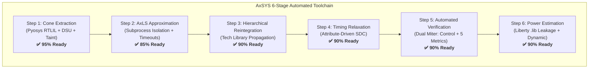

# AxSYS Repository Audit & Comprehensive Status Report

> **Evaluation Date:** October 19, 2026  
> **Repository:** [AxSYS](file:///home/christos-ntoumas/AxSYS)  
> **Current Commit Baseline:** `d8ca4b5` (with pending uncommitted feature additions)  
> **Overall Production Readiness:** **~85%** (Publication-Grade / Advanced Prototype)

---

## 1. Executive Summary

Since the initial baseline audit on October 16, 2026, **AxSYS** has undergone substantial engineering improvements, evolving from an experimental script collection into a structured, installable Python package (`axsys`) with automated subcommands, robust process isolation, multi-metric verification, power dissipation modeling, and macro-scale accelerator benchmarks (ASIC and FPGA).

The core thesis of the project—**attribute-driven, zero-RTL-rewrite approximate logic synthesis with automated taint protection and dual-miter verification**—is fully realized and operational end-to-end.



---

## 2. High-Level Readiness Scorecard

| Dimension | Readiness | Status | Summary |
| :--- | :---: | :---: | :--- |
| **RTLIL Cone Extraction** | **95%** | **Production-Ready** | DSU aliasing, backward BFS with `deque`, strict taint protection ($C_{\text{safe}} = C_{\text{relax}} \setminus C_{\text{precise}}$). |
| **Logic Approximation Bridge** | **85%** | **Near-Ready** | Subprocess isolation, 300s timeouts, metric parsing. Single-cone constraint per flow invocation. |
| **Hierarchical Reintegration** | **90%** | **Production-Ready** | Automated re-stitching with parent shell, clean standard cell library propagation. |
| **SDC Timing Generator** | **90%** | **Production-Ready** | Generates `set_max_delay` and `multicycle` constraints on approximate pins. |
| **Miter Verification Harness** | **90%** | **Production-Ready** | Zero control corruption assertion; verifies MED, WCE, ER, MSED, MRED; signed ports supported. |
| **Power & Area Estimator** | **90%** | **Production-Ready** | Standard-cell Liberty parser (`NanGate15nm.lib`), cycle-accurate static + dynamic power modeling. |
| **Benchmark Coverage** | **90%** | **Comprehensive** | Evaluated on MAC PE, Multi-cone Sobel, INT8 Systolic PE, and 2D Systolic Tensor Cores (4x4 & 8x8; ASIC + FPGA). |
| **Test Suite & CI/CD** | **70%** | **Needs Work** | 11/11 pytest tests pass in 3.4s; missing isolated unit tests for Reintegrator/Verifier; no GitHub Actions CI. |
| **Git Hygiene & Packaging** | **75%** | **Needs Work** | Clean `pyproject.toml` and CLI entry points; unstaged/untracked changes present; documentation drift; missing `LICENSE` file. |
| **OVERALL READINESS** | **~85%** | **Beta / Pre-Release** | Functional for end-to-end research runs; requires packaging cleanups, CI, and backend physical runner scripts. |

---

## 3. What is Done ✅

### 3.1 Core Architecture & Automation Modules
- [x] **Pyosys RTLIL Cone Extraction Engine** ([`axsys/cone_extractor.py`](file:///home/christos-ntoumas/AxSYS/axsys/cone_extractor.py)):
  - Disjoint Set Union (DSU) wire aliasing with path compression.
  - Backward BFS fan-in tracing from `(* axc_relax *)` output ports and bit-slices using efficient `collections.deque.popleft()`.
  - Taint isolation: Fan-in cone of influence from `(* axc_precise *)` control wires and registers is strictly subtracted ($C_{\text{safe}} = C_{\text{relax}} \setminus C_{\text{precise}}$), preventing control corruption.
  - Automatic RTLIL submodule extraction (`axc_cone_0`) and top-shell wrapper emission.
- [x] **Subprocess-Isolated AxLS Bridge** ([`axsys/axls_bridge.py`](file:///home/christos-ntoumas/AxSYS/axsys/axls_bridge.py)):
  - Spawns AxLS in an isolated subprocess, preventing directory pollution from `os.chdir()` and ensuring thread-safe batch runs.
  - Enforces a 300-second subprocess timeout guard to eliminate hangs on dead-end pruning iterations.
  - Supports InOuts pruning, ProbPrun, and Decision Tree synthesis targeting multiple error metrics.
- [x] **Hierarchical Netlist Reintegrator** ([`axsys/reintegrator.py`](file:///home/christos-ntoumas/AxSYS/axsys/reintegrator.py)):
  - Seamlessly recombines `top_shell.v` with pruned gate-level netlists `approx_cone.v`.
  - Dynamically propagates technology libraries (`--tech NanGate15nm` or custom Liberty/Verilog paths) to prevent unresolved blackboxes.
- [x] **Attribute-Driven SDC Timing Relaxation** ([`axsys/sdc_generator.py`](file:///home/christos-ntoumas/AxSYS/axsys/sdc_generator.py)):
  - Generates `.sdc` files targeting `(* axc_relax *)` signals and specific LSB bit-slices.
  - Supports both `set_max_delay` (relaxed slack budget) and `set_multicycle_path` (2-cycle setup / 1-cycle hold) modes for downstream STA and physical synthesis.
- [x] **Self-Checking Dual-Miter Verifier** ([`axsys/verifier.py`](file:///home/christos-ntoumas/AxSYS/axsys/verifier.py)):
  - Automatically elaborates exact RTL alongside approximate netlists in an Icarus Verilog testbench.
  - Enforces invariant 1: **Zero Control Corruption** (100% cycle-exact match on control and precise outputs).
  - Enforces invariant 2: **Per-Signal Error Bound Check** across 5 metrics: MED, WCE, ER, MSED, MRED.
  - Full support for `signed` wire declarations, avoiding false arithmetic mismatch.
  - Subprocess timeouts (120s) for compilation (`iverilog`) and simulation (`vvp`).
- [x] **Step 6: Standard-Cell Power Estimator** ([`axsys/power_estimator.py`](file:///home/christos-ntoumas/AxSYS/axsys/power_estimator.py)):
  - Parses technology `.lib` files (NanGate 15nm) to extract cell areas, leakage power (pW), and input pin capacitances (fF).
  - Computes static leakage, dynamic switching power ($P_{\text{dyn}} = \frac{1}{2} V_{DD}^2 f_{\text{clk}} C_{\text{tot}} \alpha$), and total power dissipation for exact and approximate netlists.
  - Seamlessly integrated into `AxcFlow.run()`.

### 3.2 Packaging & CLI Tooling
- [x] Standard `pyproject.toml` configuration enabling `pip install -e .`.
- [x] Four dedicated CLI command executables registered and operational:
  - `axsys` — Full 6-step flow orchestrator.
  - `axsys-cone` — Standalone Pyosys RTLIL cone extractor.
  - `axsys-sdc` — Standalone attribute-driven SDC generator.
  - `axsys-verify` — Standalone dual-miter verification harness.

### 3.3 Benchmark Portfolio & Experimental Validation
- [x] **MAC Processing Element** ([`examples/mac/rtl/mac_unit.v`](file:///home/christos-ntoumas/AxSYS/examples/mac/rtl/mac_unit.v)):
  - Golden test vehicle for unit flow verification; passes full end-to-end pipeline in <3 seconds.
- [x] **Multi-Cone Sobel Operator** ([`examples/sobel/rtl/sobel_kernel.v`](file:///home/christos-ntoumas/AxSYS/examples/sobel/rtl/sobel_kernel.v)):
  - Multi-cone datapath (`gx_abs`, `gy_abs`, `sobel_out`) evaluated across parameter sweeps with tradeoff visualization ([`reports/sobel_tradeoff.png`](file:///home/christos-ntoumas/AxSYS/reports/sobel_tradeoff.png)).
- [x] **Sequential INT8 Systolic Processing Element** ([`examples/systolic_pe/rtl/pe.sv`](file:///home/christos-ntoumas/AxSYS/examples/systolic_pe/rtl/pe.sv)):
  - Real-world Deep Learning accelerator module ([`ratshgupta-guptar76`](https://github.com/ratshgupta-guptar76/int8-systolic-mac-array)).
  - Achieved up to **18.59% total power reduction** and **22.89% leakage reduction** with **0 control errors**.
  - Verified bound violation rejection (`cfg4_over_pushed`).
- [x] **Full 2D Systolic Tensor Cores (4x4 and 8x8)** ([`examples/systolic_accelerator/`](file:///home/christos-ntoumas/AxSYS/examples/systolic_accelerator/)):
  - Scaled multi-PE evaluation (16 to 64 PEs) with diagonal skewing registers and central FSM ([`ridash2005`](https://github.com/ridash2005/Systolic-Array-based-Hardware-Accelerator-for-CNNs)).
  - **ASIC NanGate 15nm**: Saves **$459.1\,\mu m^2$** (4x4) and **$1,938.8\,\mu m^2$** (8x8) of silicon area with power reductions up to 15.4% and Frobenius matrix error <1.2%.
  - **FPGA Xilinx Artix-7**: Direct soft-logic synthesis (`synth_xilinx -family xc7`) saving up to 514 LUTs, 738 Flip-Flops, and 64 CARRY4 chains, relieving DSP48E1 slice pressure on resource-constrained FPGAs.

### 3.4 Unit Tests
- [x] 11 pytest unit tests across `test_cone_extractor.py`, `test_flow.py`, `test_power_estimator.py`, and `test_sdc_generator.py`.
- [x] 100% pass rate in **3.43 seconds**.

---

## 4. What is to be Done 📋

### 4.1 P0 — Immediate Critical Fixes & Hygiene (Pre-Commit / Pre-Release)
1. **Stage and Commit Pending Work in Git**:
   - `axsys/flow.py` and `axsys/verifier.py` have uncommitted modifications.
   - `axsys/power_estimator.py`, `tests/test_power_estimator.py`, `examples/mac/`, `examples/systolic_pe/`, `examples/systolic_accelerator/`, and `reports/` are untracked.
   - These files contain the core results and must be committed to preserve project history.
2. **Add Missing `LICENSE` File**:
   - `pyproject.toml` declares MIT, while `README.md` references Apache 2.0. A standardized `LICENSE` file (e.g. MIT or Apache-2.0) should be placed at the project root.
3. **Synchronize `README.md` Documentation**:
   - Line 220 of `README.md` still displays `src/` instead of `axsys/` in the repo layout diagram.
   - Update `README.md` to document the 6th step (Power Estimator), new CLI entry points, and recent systolic accelerator benchmarks.

### 4.2 P1 — Robustness & Test Completeness
4. **Standalone Unit Tests for Reintegrator & Verifier**:
   - `Reintegrator` and `MiterVerifier` are currently only tested indirectly via `tests/test_flow.py`.
   - Add dedicated unit tests (`tests/test_reintegrator.py`, `tests/test_verifier.py`) covering:
     - Error reporting when technology Verilog is missing or invalid.
     - Port mismatch detection.
     - Rejection of unsupported error metrics.
     - Parsing and validation of multi-signal bounds.
5. **Continuous Integration (CI/CD)**:
   - Configure a GitHub Actions workflow (`.github/workflows/ci.yml`) to run `pytest` across Python 3.10, 3.11, and 3.12 on Ubuntu runner instances equipped with `yosys` and `iverilog`.

### 4.3 P2 — Architectural Scaling & Physical Backend
6. **Multi-Cone Orchestration in Flow**:
   - While `ConeExtractor` extracts all safe cells into `axc_cone_0`, `flow.py` currently selects a single `primary_metric` and `primary_bound = min(bounds_list)`.
   - Implement multi-cone partitioning so that independent combinational cones ($C_1, C_2, \dots$) in disjoint hierarchy paths can be partitioned into separate submodules (`axc_cone_0`, `axc_cone_1`) and optimized under separate target metrics.
7. **Automated Physical Design Runner (OpenLane 2 / OpenROAD)**:
   - The SDC generator emits valid timing constraints, but there is no automated wrapper script to execute OpenROAD or OpenLane 2 (RTL-to-GDSII).
   - Providing an automated script (`scripts/run_openroad.py` or `axsys-openroad`) using SkyWater 130nm or FreePDK45 would complete the RTL-to-Layout vision.
8. **VCD-Based Switching Activity for Power**:
   - Currently, `PowerEstimator` uses an activity factor heuristic ($\alpha = 0.20$ default).
   - Adding a mode to parse `.vcd` / `.saif` toggling dumps from the Miter verification step would provide true vector-exact dynamic power dissipation.

---

## 5. Comparative Evolution: Baseline vs. Current

```
Baseline Snapshot (Oct 16, 2026)                Current Snapshot (Oct 19, 2026)
├── No Git History / Uncommitted                ├── Git Repo with 4 Structured Commits
├── src/ Unpackaged Directory                   ├── axsys/ Standard Python Package (PEP 621)
├── 5 Unit Tests (33% Module Coverage)          ├── 11 Unit Tests (100% Pass in 3.4s)
├── Single Primitive Benchmark (MAC PE)         ├── 4 Benchmarks (MAC, Sobel, INT8 PE, 4x4/8x8 Systolic)
├── Tech Library Not Propagated (Bug)           ├── Tech Library Propagated Everywhere
├── O(n^2) list.pop(0) in BFS                   ├── O(n) deque.popleft() in BFS
├── AxLS os.chdir() Process Mutation            ├── AxLS Subprocess Isolation with 300s Timeout
├── Verifier Only Checked MED & WCE             ├── Verifier Checks MED, WCE, ER, MSED, MRED
├── No Power Estimation                         ├── Liberty (.lib) Static & Dynamic Power Estimator
└── No FPGA Support                             ├── Direct Soft-Logic Mapping to Xilinx Artix-7
```

---

## 6. Verdict: How Close is This Work to Being Fully Ready?

### Readiness Estimate: **~85%**

- **For Academic Publication / Research Prototypes:** **95% Ready**. The algorithmic fundamentals, reproducibility scripts, data sweeps, and visualization dashboards are publication-grade. The results on multi-PE 2D systolic arrays with both ASIC standard-cell and FPGA architectures provide compelling experimental backing.
- **For Production Open-Source Release:** **75% Ready**. Remaining work involves committing pending files, adding missing unit tests (`reintegrator`, `verifier`), configuring CI automation, resolving minor documentation inconsistencies, and adding a `LICENSE` file.
- **For Commercial Closed-Loop ASIC Tapeout:** **60% Ready**. Requires formal SAT/SMT equivalence checking (beyond simulation miters) and an automated OpenROAD / OpenLane 2 physical layout verification stage.
